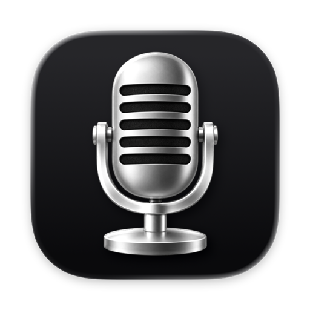
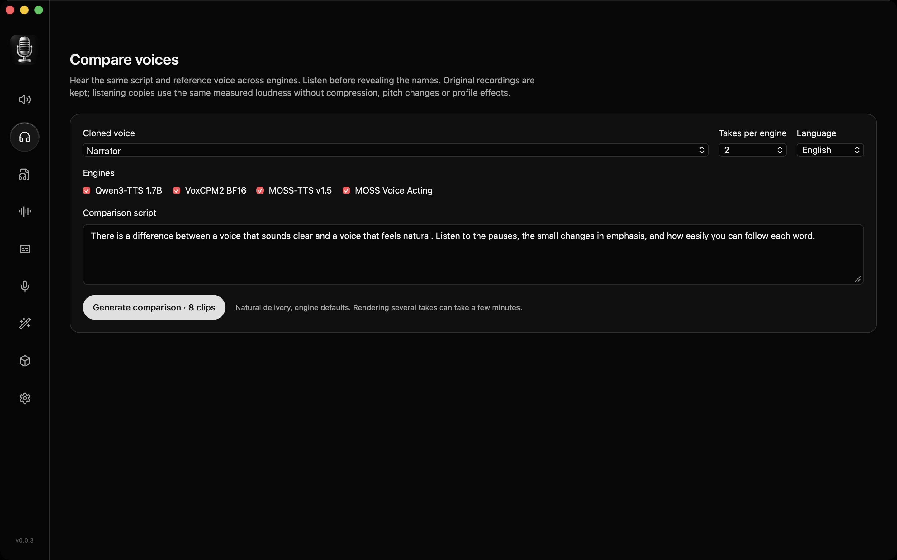
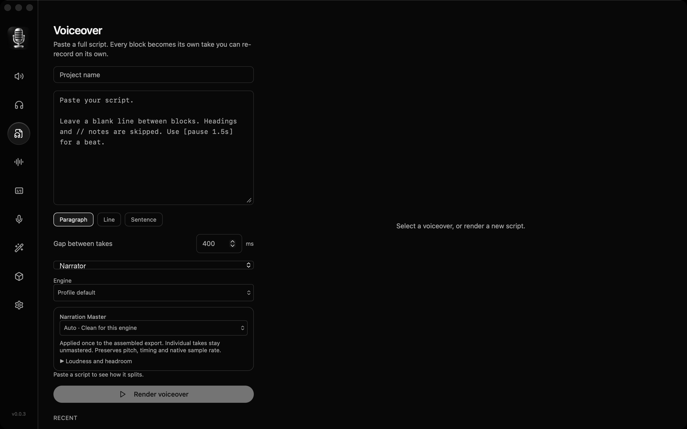
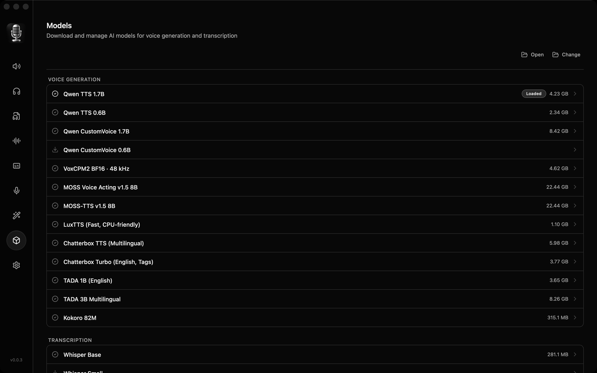

  

<h1 align="center">VoiceBUX</h1>

  Free local speech studio for Apple Silicon Macs. 
  A fork of <a href="https://github.com/jamiepine/voicebox">Voicebox</a> with extra engines and a side-by-side compare tool.

  

The button downloads the compiled Mac app. It is free. No account is required.

## Download

This build is for Apple Silicon only, on macOS 11 or later. It will not run on an Intel Mac.

The file is signed with an Apple Developer ID and notarized by Apple, so Gatekeeper can open it.

- Version: 0.0.3
- File: [VoiceBUX-0.0.3-macOS-arm64.dmg](https://github.com/byteforwardyt/VoiceBUX/releases/download/v0.0.3/VoiceBUX-0.0.3-macOS-arm64.dmg) (592 MB)
- SHA-256: `60a7b19513a819a9d1f091426f1b7fdd55c9c9fd63cf4098c20a94b7b5d2d0a3`

1. Click the download button.
2. Open the disk image.
3. Drag Voicebux into Applications.
4. Open Voicebux from Applications.

macOS may ask once to confirm an app downloaded from the internet. That prompt is normal.

Speech models are not inside this download. The first time you use an engine, VoiceBUX downloads that model onto your Mac. Large models, especially MOSS, need a lot of disk space and memory.

Your voices and history stay on this Mac, in `~/Library/Application Support/local.voicebux.desktop`.

## The app

These are screens from the installed 0.0.3 app.

  

Compare plays one script and one reference voice across engines. You can listen before the names are shown.

  

Voiceover turns a full script into separate takes, then exports one mixed file.

  

Models download inside the app. This build can use Qwen, VoxCPM2, MOSS, LuxTTS, Chatterbox, TADA, Kokoro, and Whisper.

## What changed from Voicebox

VoiceBUX started from Voicebox and added engines the original build did not have.

| | Voicebox | VoiceBUX 0.0.3 |
| --- | --- | --- |
| Qwen TTS | Yes | Yes, 0.6B and 1.7B |
| Qwen CustomVoice | Yes | Yes, 0.6B and 1.7B |
| LuxTTS | Yes | Yes |
| Chatterbox and Chatterbox Turbo | Yes | Yes |
| TADA | Yes | Yes, 1B and 3B multilingual |
| Kokoro | Yes | Yes |
| VoxCPM2 | No | Yes, 48 kHz |
| MOSS-TTS v1.5 8B | No | Yes, 31 languages |
| MOSS Voice Acting v1.5 8B | No | Yes |
| Side-by-side compare | No | Yes |
| Qwen VoiceDesign | Yes, in the current original | Not in this build |
| OmniVoice | Yes, in the current original | Not in this build |

The current original project is [jamiepine/voicebox](https://github.com/jamiepine/voicebox). It has moved on since this fork. VoiceBUX does not include Qwen VoiceDesign or OmniVoice. Those two are in today's Voicebox, not in this download.

Compare in VoiceBUX can render one line on Qwen3-TTS 1.7B, VoxCPM2, MOSS-TTS, and MOSS Voice Acting, then reveal which engine made each take.

## License

MIT. VoiceBUX is free to download and use. The original Voicebox copyright is in [LICENSE](LICENSE). Model and third-party licenses still apply to the engines you download. Do not clone a person's voice without their permission.
